# Course Registration System — DevOps CIA2

## 1. Introduction

This project focuses on improving a Course Registration System and applying DevOps practices to build, test, and deploy it.

The work includes fixing registration defects, improving the test cases, restructuring the project into a Maven multi-module project, and automating the build using Jenkins.

I also used Kubernetes to deploy an Nginx application and verify scaling and automatic Pod replacement.

## 2. Technologies Used

- Java 17
- Maven
- JUnit 5
- Git and GitHub
- Jenkins
- Docker
- Kubernetes
- Minikube
- Nginx

## 3. Defect Fixes and Changes

### 3.1 Course Capacity Validation

Initially, the registration logic did not correctly handle the situation where a course had already reached its maximum capacity.

I corrected the capacity check so that a student cannot register for a full course.

The updated condition is:

```java
if (course.getCurrentEnrollment() >= course.getCapacity()) {
    return false;
}
```

This ensures that registration is rejected when the current enrollment is equal to or greater than the course capacity.

I added tests to verify two cases:

- Registration is rejected when the course is full.
- Registration is allowed when one seat is still available.

A rejected registration must not change the student's registrations, total credits, or the course's enrollment count.

**Before the fix:**

<!-- Add your screenshot here: 02-capacity-defect-before-fix.png -->

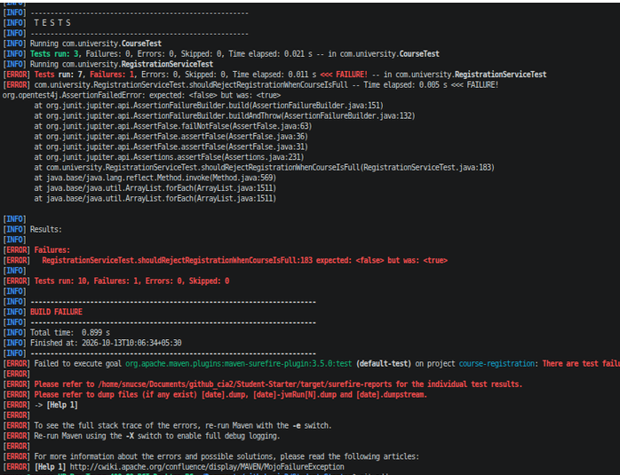

**After the fix:**

<!-- Add your screenshot here: 03-capacity-fix.png -->

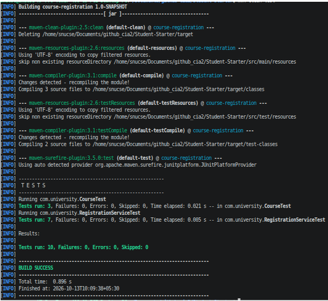

**Test results:**

<!-- Add your screenshot here: 04-capacity-boundary-tests-pass.png -->

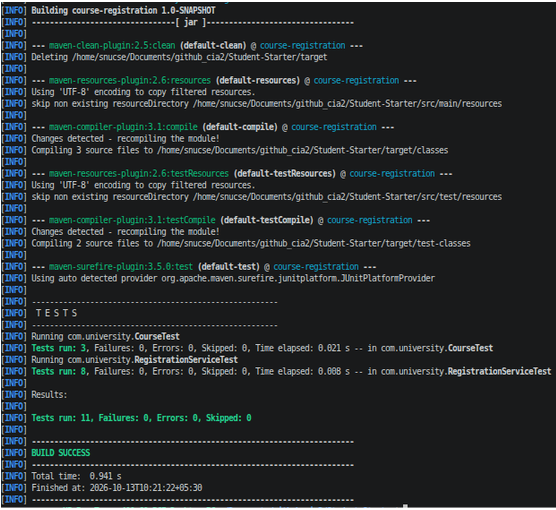

### 3.2 Credit Limit Change

The maximum credit limit was changed from 20 to 24 credits.

I added tests to verify that:

- A student can register for a course when the total reaches exactly 24 credits.
- Registration is rejected if the total would exceed 24 credits.
- A rejected registration does not change the student's registration details, total credits, or course enrollment.

These tests help verify that the credit limit is enforced correctly at the boundary.

<!-- Add your screenshot here: 05-credit-limit-tests-pass.png -->

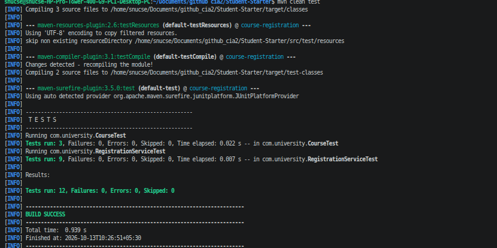

## 4. Maven Multi-Module Structure

The project was reorganized into a Maven multi-module structure.

The root `pom.xml` acts as the parent project, while `course-registration-app` contains the application source code and tests.

The parent POM manages the JUnit 5 dependency version and the Maven compiler and Surefire plugin versions. The child module inherits these configurations.

The simplified structure is:

```text
Student-Starter/
├── pom.xml
├── course-registration-app/
│   ├── pom.xml
│   └── src/
│       ├── main/
│       │   └── java/
│       └── test/
│           └── java/
├── Jenkinsfile
├── k8s/
│   ├── deployment.yaml
│   └── service.yaml
└── README.md
```

### Build and Test

Run the following commands from the project root.

Clean and run the tests:

```bash
mvn clean test
```

Package the application:

```bash
mvn package
```

The test reports are generated under:

```text
course-registration-app/target/surefire-reports/
```

The packaged JAR is generated under:

```text
course-registration-app/target/
```

### Test Results

The root-level Maven test run completed successfully with the following results:

| Test Class | Tests | Failures | Errors |
|---|---:|---:|---:|
| CourseTest | 3 | 0 | 0 |
| RegistrationServiceTest | 9 | 0 | 0 |
| **Total** | **12** | **0** | **0** |

The build reported `BUILD SUCCESS`.

<!-- Add your screenshot here: 06-maven-multimodule-build.png -->

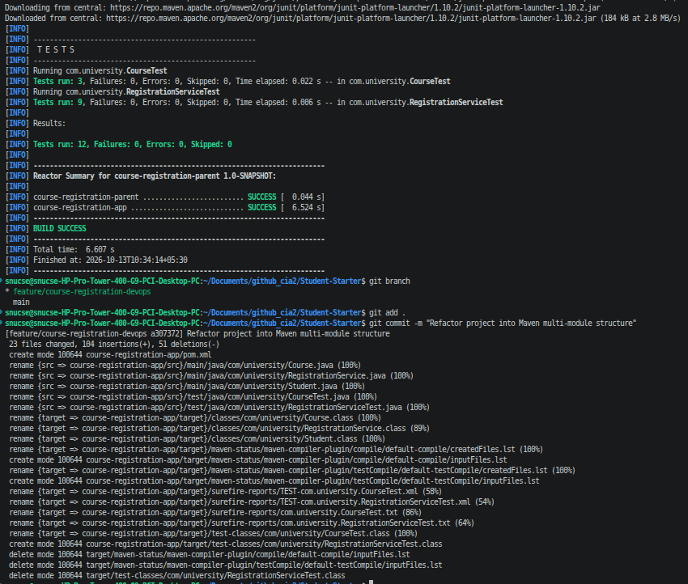

## 5. Jenkins CI Pipeline

A Jenkins Declarative Pipeline was created in the root `Jenkinsfile`.

The pipeline automates the build and test process.

### Pipeline Stages

1. **Checkout:** Retrieves the project source code.
2. **Test:** Runs `mvn clean test` from the project root.
3. **Package:** Packages the application after the test stage succeeds.

The pipeline also publishes JUnit test reports and archives the generated JAR when the pipeline succeeds.

If the test stage fails, the pipeline does not proceed to the packaging stage.

### Jenkins Result

The Jenkins build result and stage execution are shown below.
#### Jenkins Build 
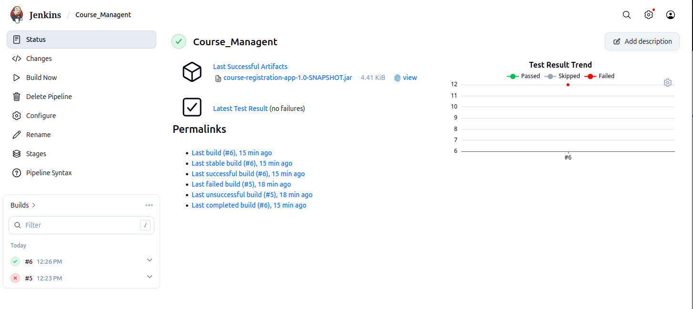
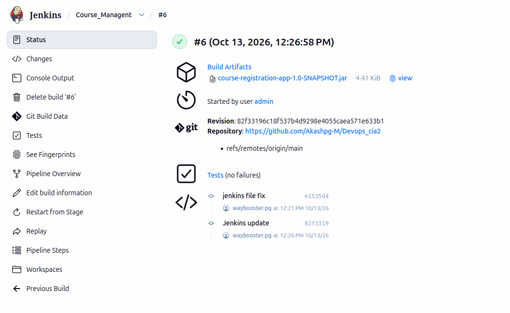

#### Jenkins Success Pipeline


## 6. Kubernetes Deployment

Minikube was used to deploy Nginx to a local Kubernetes environment.

The deployment uses the `nginx:1.27` image and initially runs two replicas.

A NodePort service exposes the application through port `30080`.

### Service.yaml
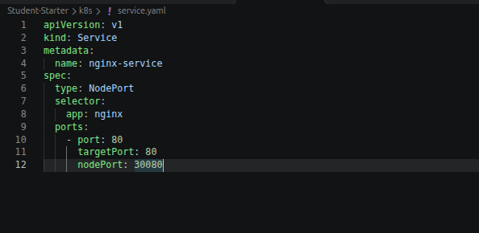

### Deployment.yaml

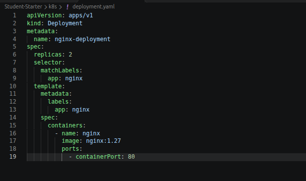

### 6.1 Initial Deployment

The deployment and service were applied using:

```bash
kubectl apply -f k8s/deployment.yaml
kubectl apply -f k8s/service.yaml
```

The initial deployment was checked using:

```bash
kubectl get deployments
kubectl get pods
kubectl get services
```

The expected initial state is two running Nginx replicas.


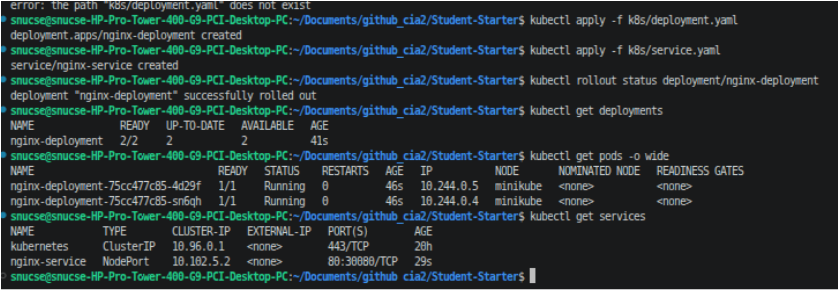

### 6.2 Scaling the Deployment

The deployment was scaled from two replicas to three:

```bash
kubectl scale deployment/nginx-deployment --replicas=3
```

The deployment status was checked using:

```bash
kubectl get deployments
kubectl get pods -l app=nginx
```

The deployment should show three running replicas after scaling completes.


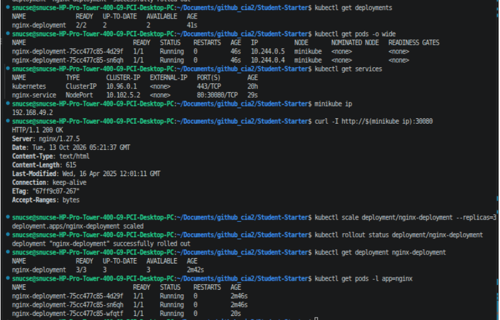

### 6.3 Pod Self-Healing

To verify Kubernetes self-healing, one of the Nginx Pods was deleted manually.

For example:

```bash
kubectl get pods -l app=nginx
```

After identifying a Pod, it was deleted using:

```bash
kubectl delete pod <pod-name>
```

The replacement Pods were checked using:

```bash
kubectl get pods -l app=nginx
```

The Deployment controller creates a replacement Pod to maintain the desired replica count.

<!-- 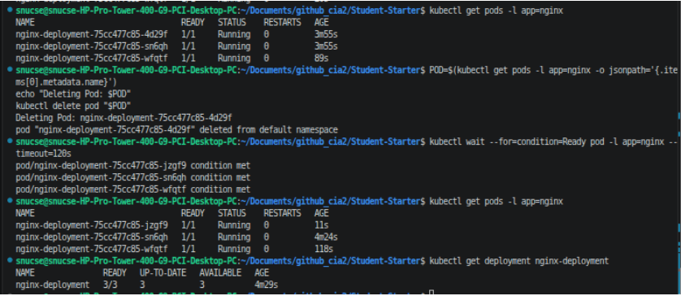 -->


## 7. Git Workflow and Commit History

Git was used to manage the changes throughout the project.

A feature branch was used for development so that the fixes and DevOps changes could be committed separately before being merged into the main branch.

The workflow included:

1. Creating and working on the feature branch.
2. Fixing the course capacity validation defect.
3. Adding regression tests for course capacity.
4. Updating the credit limit to 24 credits and adding boundary tests.
5. Refactoring the project into a Maven multi-module structure.
6. Adding the Jenkins pipeline.
7. Adding the Kubernetes deployment and service manifests.
8. Updated the README with the implementation details and project evidence.
9. Verified the changes and reviewed the Git commit history.
10. Merged the completed feature branch into `main`.

### Final Git Commit History

The final Git history is included below to show the sequence of changes made during the project.

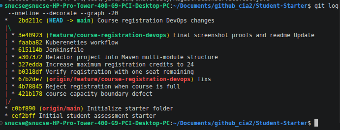

## 8. Project Evidence

The screenshots included in this README document the main stages of the work:

| Screenshot | Description |
|---|---|
| `capacity-defect-before-fix.png` | Failing capacity regression test before the fix |
| `capacity-fix.png` | Corrected capacity validation condition |
| `capacity-boundary-tests-pass.png` | Passing course capacity boundary tests |
| `credit-limit-tests-pass.png` | Passing credit limit boundary tests |
| `maven-multimodule-build.png` | Successful root-level Maven build and tests |
| `kubernetes-initial-deployment.png` | Initial deployment with two Nginx replicas |
| `kubernetes-scaled-to-three.png` | Deployment scaled to three replicas |
| `kubernetes-self-healing.png` | Pod deletion and replacement |
| `jenkins-success.png` | Successful Jenkins pipeline and test results |
| `final-git-history.png` | Final Git commit and merge history |

## 9. Conclusion


The course registration defects were fixed and covered by regression tests. The Maven project was reorganized into multiple modules, and a Jenkins pipeline was added to automate testing and packaging.
Kubernetes was used to deploy Nginx, scale the deployment, and verify Pod replacement after deletion.
The Git history records the changes made during development and the final integration of the work.